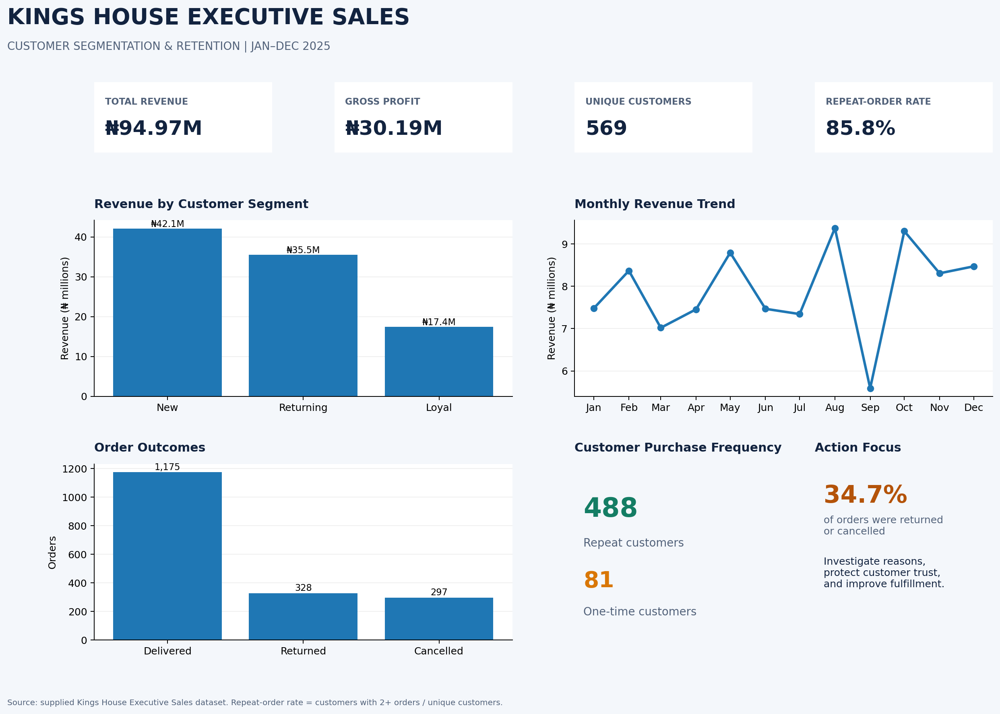

# Executive-Sales-Project-Analysis
Kings_House_Executive_Sales_Project 

# Business Problem 
Kings House Executive Sales faces the challenge of understanding its customers' purchasing behaviour, identifying its most valuable customer segments, and developing effective strategies to improve customer retention and sales performance.
Although the business has recorded significant sales transactions, it is important to determine how much revenue comes from new and returning customers, how frequently customers make repeat purchases, and which customer groups contribute most to overall revenue and profitability. Additionally, the high number of returned and cancelled orders raises concerns about potential revenue losses, customer satisfaction, and long-term loyalty.
Without a clear understanding of these factors, the business may struggle to identify customers at risk of becoming inactive, convert first-time buyers into repeat customers, and allocate marketing resources effectively.

# Objectives
The objective of this project is to analyse Kings House Executive Sales' transaction data to segment customers based on their purchasing behaviour, evaluate repeat-purchase patterns and retention, identify revenue trends, and investigate order outcomes.
The analysis aims to provide actionable, data-driven recommendations that will help the business improve customer loyalty, reduce returns and cancellations, increase repeat purchases, and achieve sustainable revenue growth.

# Data Set 
The analysis covers sales transactions from January to December 2025.

Total orders - 1,800
Unique customers - 569
Recorded revenue - ₦94,966,142.60
Gross profit - ₦30,190,494.22
Gross margin - 31.79%
Average order value - ₦52,758.97
Customers with multiple orders - 488
Observed repeat-order rate - 85.76%

# Project Workflow 

The Customer Segmentation and Retention Analysis project followed a structured data analytics workflow to transform raw sales transaction data into meaningful business insights and actionable recommendations.

1. Business Understanding

Identified the key business challenges facing Kings House Executive Sales, including understanding customer purchasing behaviour, improving customer retention, identifying valuable customer segments, and investigating returned and cancelled orders.

2. Data Collection

Imported the Kings House Executive Sales dataset in Microsoft Excel format. The dataset contained sales transaction records used to examine customer purchases, revenue, profitability, order status, and purchasing patterns.

3. Data Exploration

Conducted an initial assessment of the dataset to understand its structure, identify relevant columns, examine data types, and evaluate the completeness and consistency of the available records.

4. Data Cleaning and Preparation

Prepared the dataset for analysis by:

- Checking for missing values and duplicate records.
- Reviewing data types and formatting.
- Standardising relevant categorical values.
- Validating transaction dates and numerical fields.
- Checking the consistency of revenue, profit, and order status information.
- Preparing customer-level and time-based data for further analysis.

5. Exploratory Data Analysis (EDA)

Analysed the dataset to identify trends and patterns in sales performance, customer activity, and order outcomes. Key metrics included total revenue, gross profit, gross margin, average order value, order volume, and unique customers.

6. Customer Segmentation

Grouped customers according to their purchasing behaviour and order frequency to distinguish new, returning, and loyal customer groups. Compared the segments based on customer counts, order volumes, and revenue contribution.

7. Customer Retention Analysis

Evaluated repeat-purchase behaviour and examined customer activity across the available observation period. Prepared cohort-based retention analysis to explore whether customers continued purchasing after their initial transactions.

8. Sales and Order Status Analysis

Examined monthly revenue trends and the distribution of delivered, returned, and cancelled orders. This step helped identify operational issues that could affect customer satisfaction and business performance.

9. Data Visualization and Dashboard Development

Created a clean dashboard presenting key performance indicators, customer segment comparisons, revenue trends, order status distributions, and retention insights. The dashboard was designed to make the findings easier for business stakeholders to understand.

10. Key Findings and Business Recommendations

Interpreted the results to identify opportunities for improving customer loyalty, increasing repeat purchases, investigating returns and cancellations, and strengthening revenue performance.

11. Reporting and Documentation

Compiled the analysis, visualisations, key findings, and recommendations into a structured project report. Documented the workflow, tools, and results to support transparency and reproducibility.

12. Project Delivery

Organised the project files, analysis scripts, dashboard image, and supporting outputs into a GitHub-ready repository for documentation, portfolio presentation, and future improvements.

Tools Used

- Microsoft Excel: Source dataset and preliminary data inspection.
- Python: Data processing and analysis.
- Pandas: Data cleaning, transformation, and aggregation.
- NumPy: Numerical calculations.
- Matplotlib: Dashboard charts and visualisations.
- GitHub: Project versioning, documentation, and portfolio presentation.

Expected Business Outcome

The workflow provides Kings House Executive Sales with a clearer understanding of customer purchasing patterns, customer segment performance, repeat-purchase behaviour, and order outcomes. These insights can support more targeted marketing, stronger customer relationships, improved operational decisions, and sustainable business growth.

# Tools Used
Microsoft Excel 

# Recommended Next Steps
To strengthen the business analysis, Kings House should prioritize:
- Converting first-time buyers into repeat customers through targeted follow-ups.
- Developing a loyalty programme based on purchase frequency, recency, and profitability.
- Investigating the causes of returns and cancellations.
- Tracking customer retention by monthly acquisition cohort.
- Evaluating acquisition channels based on customer lifetime value and profitability, not just revenue.

# Dashboard 

# Author
Aigbiremhon Sylvester Osazeme| student @ BoyCode Africa Data Analysis Program
